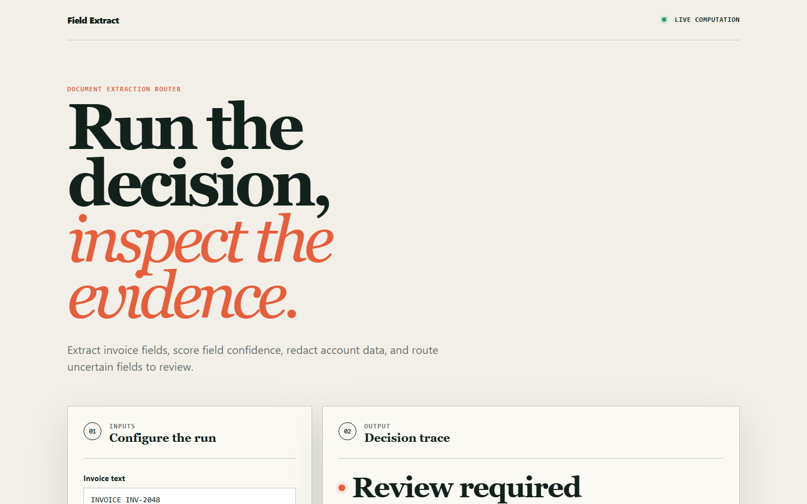
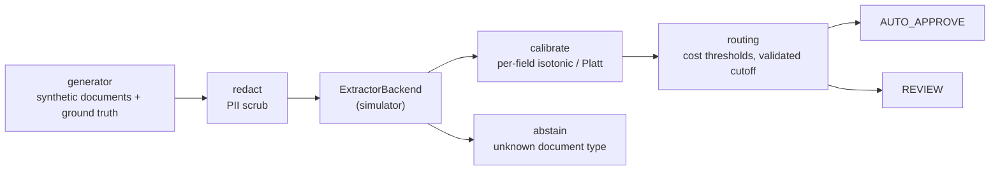

# fieldextract

Document field extraction with per-field calibrated confidence, routed to human review at a cost-optimal threshold.

[](https://github.com/SlateGitOrg/fieldextract/actions/workflows/ci.yml)
[Live demo](https://slategitorg.github.io/fieldextract/)



## Why

An insurer receives repair invoices, police reports and medical summaries as scanned PDFs. Keying everything by hand is expensive; automating everything puts wrong numbers into claim payments. The useful question is not "how accurate is the model" but "which fields can be trusted, and where exactly does a human belong". A single accuracy figure cannot answer that, and a raw model score is usually overconfident. fieldextract calibrates a confidence per field and derives the review threshold from the actual cost of an error versus the cost of a review.

## Features

- Per-field confidence calibration (isotonic and Platt) with reliability tables, ECE and Brier score.
- Cost-optimal routing threshold per field, `1 - review_cost / escape_cost`, from a configurable cost table.
- Target-error routing: a cutoff chosen on a labelled validation split to meet a stated error rate at minimum review volume.
- PII redaction (SSN, phone, email, Luhn-valid card numbers) before any text reaches a model.
- Explicit abstain path for unrecognised document types.
- Pluggable `ExtractorBackend` interface; the shipped backend is a deterministic, seeded simulator.
- Standard library only, with a browser version of the decision workflow in `site/`.

## Architecture



Documents are split into a fit set and a held-out evaluation set. Calibrators are fitted on the fit split only, and routing policies are scored in dollars on the held-out split. The extraction backend sits behind a single interface, `extract(document) -> [Extraction(doc_id, field, value, raw_confidence, ...)]`, so a real OCR plus vision-language stack can replace the simulator without changing anything above it.

## Quick start

Requires Python 3.11+. There are no dependencies to install.

```bash
git clone https://github.com/SlateGitOrg/fieldextract.git
cd fieldextract
python -m unittest discover -s tests -v   # 51 tests
python -m src.demo                        # the full measured walkthrough
```

## Example

`python -m src.demo` runs 4,000 seeded synthetic documents and prints the calibration and routing results (trimmed):

```text
2. What does a confidence of 0.9 mean? (raw scores, held-out)
  ECE 0.0290   Brier 0.0574
  Fields the extractor scored 0.99 or above are correct 98.1% of the time (n=3771).

3. After per-field isotonic calibration (fitted on the fit split only)
  ECE 0.0048   Brier 0.0568
  ECE reduced 6.0x.

5. The cost model, and the thresholds it forces
  review cost per field : USD 2.50
  invoice_total          USD 220.00     0.98864
  policy_number          USD  60.00     0.95833
```

## Results

All figures come from `python -m src.demo` on the simulated backend. They show that the pipeline works; they are not model benchmarks.

| Measure | Value |
|---|---|
| Raw-confidence ECE (held-out) | 0.0290 |
| ECE after per-field isotonic calibration | 0.0048 (6.0x lower) |
| Cost-derived thresholds (review USD 2.50) | invoice_total 0.98864, policy_number 0.95833, incident_date 0.94444, claimant_name 0.86111, damage_description 0.58333 |
| Total cost at equal review budget (4,817 reviews): global raw / global calibrated / per-field | USD 32,896 / 28,762 / 18,518 |
| Errors caught on the two costliest fields: global raw vs per-field | 112 vs 207 |
| Validated-cutoff routing at 0.3% / 1% / 2% target: auto-approved | 15.1% / 43.8% / 65.6% |
| Realised escape rate at those targets | 0.17% / 0.87% / 2.15% |
| Same targets with raw scores treated as probabilities | 0.84% / 2.90% / 4.47% |
| Planted PII strings leaked after redaction (500 docs) | 0 (a naive digit-run rule destroys 500/500 policy numbers) |

In short, per-field cost-optimal routing costs 1.78x less than one tuned global threshold for the same 4,817 reviews, and a validated cutoff meeting a 1% field-error target auto-approves 43.8% of fields at a realised 0.87% error on held-out data.

## Design notes

- **Thresholds come from costs.** Each field has an escape cost and a shared review cost; the threshold follows from them instead of a hand-picked 0.9. An invoice total and a free-text damage description rightly get very different thresholds.
- **Calibration is checked, not assumed.** Reliability tables and ECE are computed on held-out data, and calibrators are fitted only on the fit split (a leakage guard raises `LeakageError`).
- **Point estimates were not enough.** Budgeting to a target error rate from calibrated point estimates overshot (0.3% requested gave about 0.48% realised) because the top isotonic blocks fit optimistically. The target is now enforced with a cutoff picked on a labelled validation split.
- **Isotonic vs Platt.** Measured on this backend the two are indistinguishable (`test_isotonic_and_platt_are_indistinguishable_here`).
- **Redaction avoids false positives.** Card numbers are matched with a Luhn check, so policy numbers are not destroyed the way a naive digit-run rule destroys them.
- **Abstain over guess.** An unrecognised document type is routed out explicitly, since a confidently wrong figure on a claim payment is the expensive failure.

## Testing

```bash
python -m unittest discover -s tests -v
node --test site/core.test.mjs        # browser-side logic (Node 20+)
python scripts/validate_site.py
```

Tests cover calibration error bounds on held-out data, routing policy cost and target-error behaviour, extractor error profiles, PII redaction, and golden outputs per document type.

## Project layout

```text
src/
  generator.py    synthetic documents with ground truth
  extractor.py    ExtractorBackend interface + simulator
  calibrate.py    isotonic, Platt, per-field calibration, ECE/Brier
  fields.py       field specs and cost table
  routing.py      policies, thresholds, validated cutoff
  redact.py       PII redaction
  demo.py         measured walkthrough
tests/            unittest suite
site/             in-browser version of the decision workflow
docs/             architecture notes and screenshots
```

## Limitations

- The simulator decides both the error process and how miscalibrated the scores are, so transfer of calibration and routing to a real OCR/VLM model is untested.
- Per-field routing lets more errors through by count (450 vs 213) and fewer by cost. The result depends on the escape-cost table in `src/fields.py`, which is illustrative, not actuarial.
- Review is assumed to catch every error it sees.
- At a 0.3% target the test split has only a few dozen errors, so the realised rate is noisy across seeds (0.19-0.50% over 8 seeds).
- For a count-based target, raw scores with a validated cutoff do about as well as calibrated ones; calibration matters for cost-based thresholds and for reading a score as a probability.
- No OCR engine, database, service layer, review UI or drift monitor is included. Redaction is pattern-based.

## License

MIT — see [LICENSE](LICENSE).
