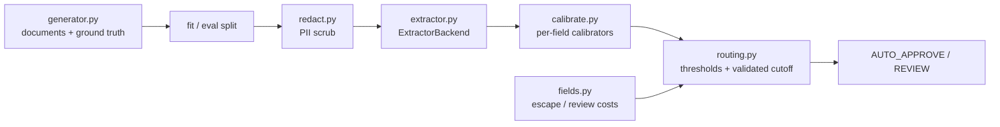

# Architecture

## Context

Insurance claims intake produces scanned documents whose fields (invoice total, policy number, incident date, claimant name, damage description) feed payments. Operations needs to know which extracted values can be auto-approved and which need a person, at the lowest total cost.

## Components

## Key decisions

- **Backend interface.** Extraction is behind `ExtractorBackend`. The shipped implementation is a seeded simulator with field-specific error profiles, so every result is reproducible. A real OCR/VLM backend implements `extract(document)` and nothing else changes.
- **Cost-derived thresholds.** `threshold = 1 - review_cost / escape_cost` per field. Alternative considered: one global threshold tuned for a review budget; it costs more at equal review volume because fields differ in error profile and escape cost.
- **Calibration on a separate split.** Calibrators are fitted on the fit split and evaluated on held-out data to avoid optimistic ECE.
- **Validated cutoff for target error.** Calibrated point estimates overshoot at tight targets, so cutoffs are chosen on a labelled validation split.

## Failure modes

- Unrecognised document type: explicit abstain path, no best guess.
- Calibrator fitted on data that overlaps the evaluation set: raises `LeakageError`.
- Over-redaction: Luhn-checked card matching keeps identifiers like policy numbers intact.

## Out of scope

OCR, persistence, a service layer, a review UI and drift monitoring are not implemented.
